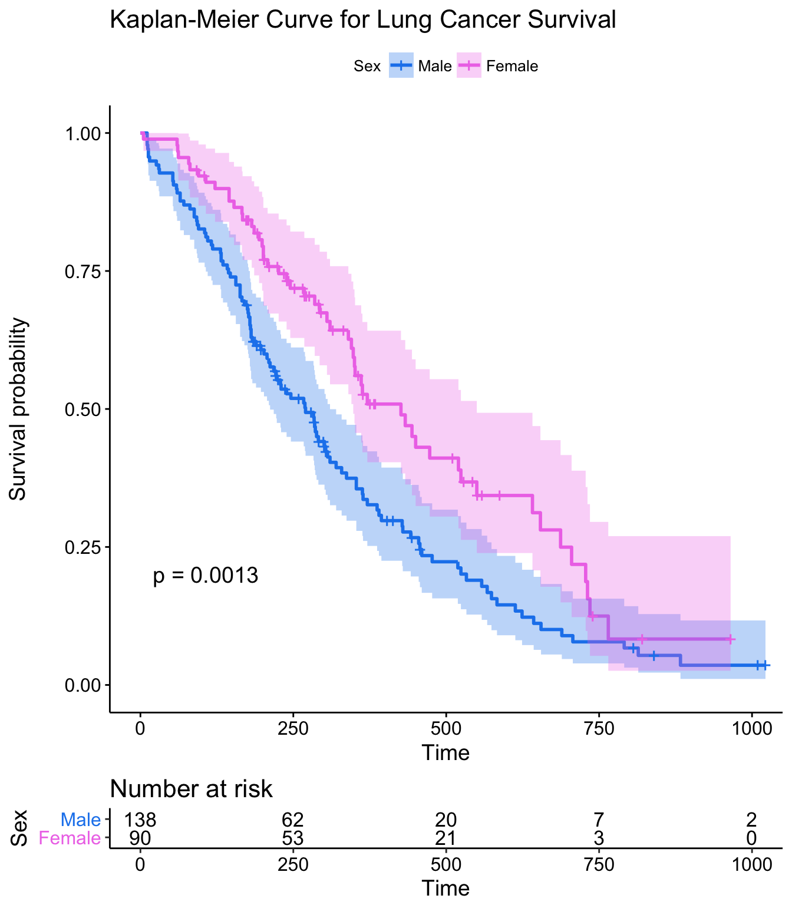
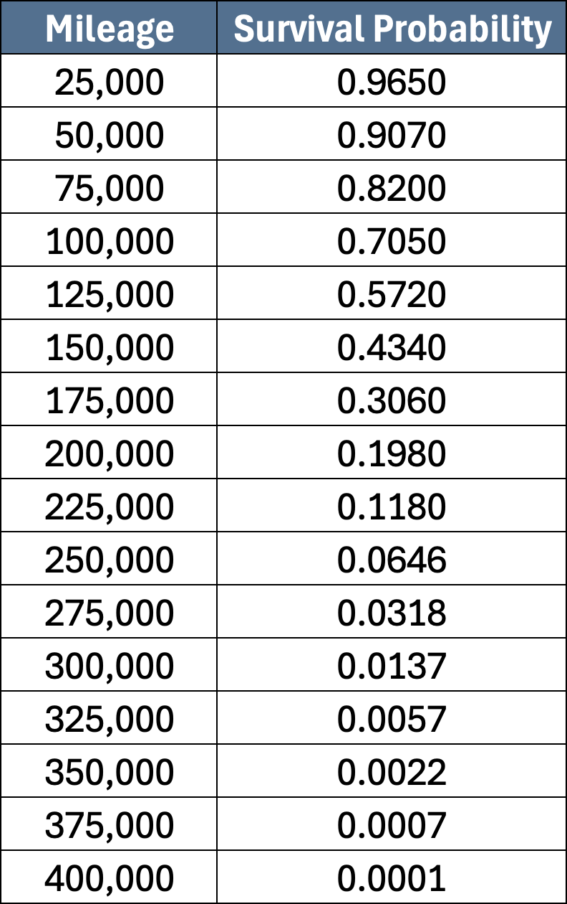
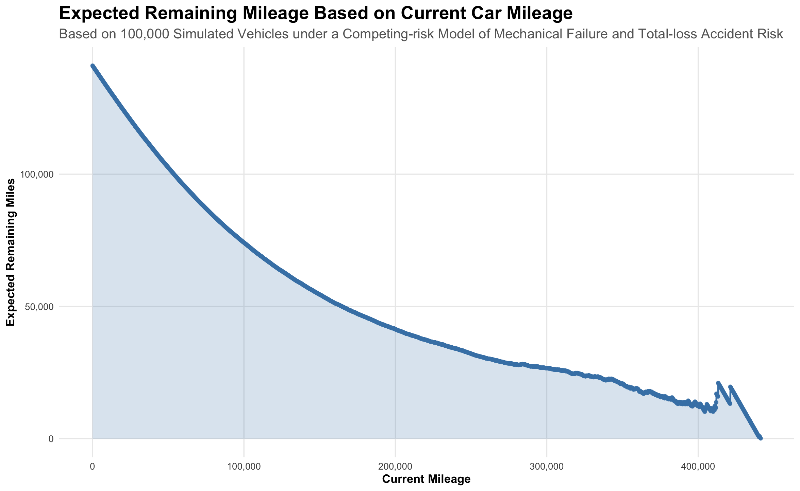
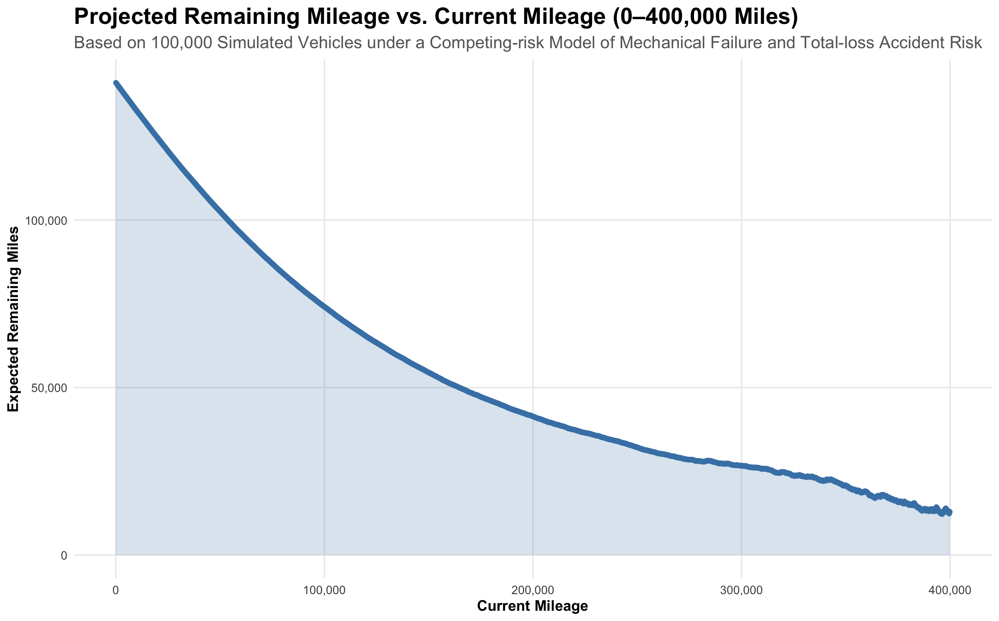
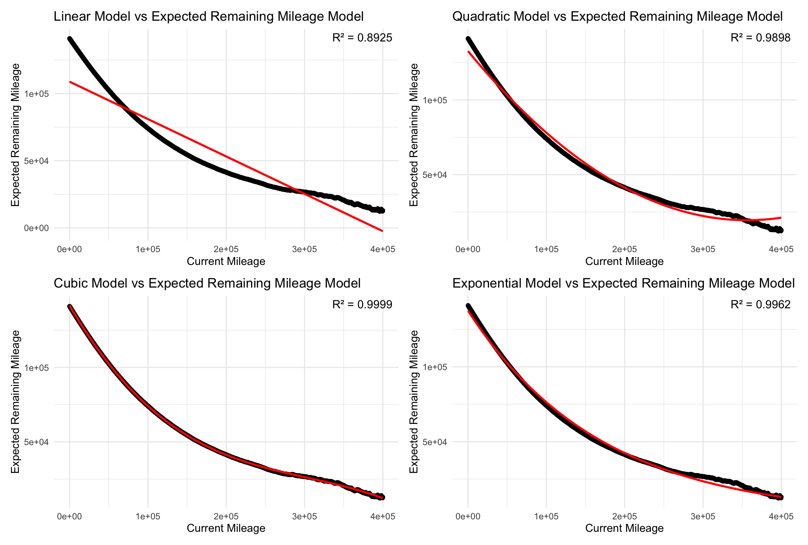

---
title: "**Modeling Car Lifetime Using Monte Carlo Simulation and Survival Analysis: A Competing Risks Approach**"
author: "**Yousif Najat**"
date: "July 2026"
format:
  pdf:
    documentclass: article
    fontsize: 11pt
    papersize: letter
    geometry:
      - margin=1in
    toc: true
    toc-depth: 2
    number-sections: true
    colorlinks: true
    linkcolor: black
    urlcolor: black
    citecolor: black
    keep-tex: false
    fig-pos: "H"
    fig-cap-location: bottom
    tbl-cap-location: top
    lof: true
execute:
  echo: false
  warning: false
  message: false
editor_options:
  markdown:
    wrap: 72
header-includes:
  - \usepackage{xcolor}
  - \usepackage{caption}
  - \captionsetup[figure]{labelfont=bf,textfont=normalfont,position=bottom,skip=8pt}
  - \captionsetup[table]{labelfont=bf,textfont=normalfont,position=top,skip=8pt}
  - \usepackage{float}
  - \usepackage{microtype}
  - \usepackage{setspace}
  - \setstretch{1.12}
  - \setlength{\parskip}{5pt}
  - \setlength{\parindent}{0pt}
---

# Project Overview

Owning a car can come with a great deal of uncertainty—from the random "Check Engine" light that flashes on an ordinary Tuesday morning to the unexpected accident that takes a vehicle off the road entirely. While some cars remain reliable for hundreds of thousands of miles, others experience major failures much earlier due to mechanical deterioration or collisions. Understanding a car's lifetime and estimating how much longer a vehicle can be used for are important considerations for manufacturers, warranty providers, insurers, and consumers.

By simulating thousands of cars and their failures, this project will utilize Monte Carlo simulations and survival analysis to develop a stochastic model for estimating car lifetimes and expected remaining mileage. The model will treat car failure as the result of two independent, competing risks:

1. **Mechanical retirement**, where cumulative wear and deterioration eventually result in a failure that makes a car's repair economically or practically unreasonable. That said, throughout a car's lifetime, numerous minor mechanical issues and routine repairs may occur before retirement. Thus, instead of modeling each repair separately, this project groups these smaller repairs into the overall deterioration process and focuses on the point at which the vehicle is ultimately retired due to mechanical trouble.

2. **Total-loss accidents**, where a collision renders a car inoperable or uneconomical to repair.

# Background & Methodology

This section introduces the key concepts used to model car lifetimes and estimate expected remaining mileage. These concepts include survival analysis, Weibull and exponential distributions, Monte Carlo simulations, and competing risks.

## Modeling Mechanical Retirement: Weibull Distribution

Formulated by Swedish engineer and mathematician Waloddi Weibull, the Weibull distribution has become a cornerstone of reliability engineering due to its ability to represent different failure patterns depending on its parameter values. For this reason, this project will apply the Weibull distribution to model mechanical retirement mileages, which we will denote by $T_m$. In other words, $T_m \sim Weibull(k, \lambda)$, where $k$ is the shape parameter and $\lambda$ is the scale parameter. 

To better understand the Weibull distribution and how the mechanical retirement model will be constructed, it will be important for us to understand these two parameters. Therefore, the two parameters are discussed more in detail below.

### Shape Parameter ($k$)

The shape parameter controls how failure risk changes over time in the Weibull distribution.


$k < 1$: Decreasing Failure Risk

- This represents situations where early failures are caused by defects, and surviving components become more reliable over time.

$k = 1$: Constant Failure Risk

- This is equivalent to an exponential distribution, where failure risk is independent of the variable it's measured against.

$k > 1$: Increasing Failure Risk

- This represents aging and deterioration, where failure risk increases over time.
- There are varying levels for $k$ values over 1, each with their own meaning and use.^[For more information, see here: https://support.ptc.com/help/wrr/r13.0.1.0/en/index.html#page/wrr/PractitionersGuide/UnderstandingWeibullAnalysis.html]


Because cars generally become more likely to experience mechanical issues as mileage increases (as mechanical parts age and wear out with more use), this project will use a Weibull distribution with $k > 1$.

### Scale Parameter ($\lambda$)

The scale parameter defines the spread of the Weibull distribution and can either stretch or compress the distribution. It also represents the 63.2nd percentile.


## Modeling Total-loss Accidents: Exponential Distribution

Mechanical deterioration is not the only reason vehicles stop operating. A car may also be destroyed through a total-loss accident, defined as an accident that results in irreparable damage or damage to the point where repair costs outweigh the car's value.

Unlike mechanical retirement, which is expected to become more likely as a car accumulates mileage, this project assumes that the risk of experiencing a total-loss accident per mile remains approximately constant and independent of mechanical retirement. In other words, the model assumes that the rate of total-loss accidents does not change with accumulated mileage and that the occurrence of a total-loss accident is independent of the mechanical retirement process.^[To further reiterate, these are *assumptions* made within this particular model and may not fully represent reality. In practice, total-loss accident risk may depend on many factors, including driving behavior, road conditions, weather, vehicle usage, geographic location, and the number of miles driven. While these factors may influence the true risk and rate of total-loss accidents, assuming a constant accident rate provides a simplified framework for understanding car lifetime mileages.]

Because of these assumptions, the mileage at which total-loss accidents occur can be appropriately modeled with an exponential distribution, $T_a \sim Exponential(\lambda)$, where $T_a$ is the variable representing the mileage at which a total-loss accident occurs and $\lambda$ is the constant rate of occurrence for total-loss accidents.

In this project, $\lambda$ will also be estimated using real-world statistics.

## Simulating Car Lifetimes: Monte Carlo Simulations

Named after the famous casino town of Monte Carlo, Monte Carlo simulations have become powerful tools for estimating possible outcomes when dealing with uncertain events. By repeatedly sampling random values from probability distributions, these simulations generate a range of possible outcomes which can help us understand their likelihood.

Because of this capability, this project will use Monte Carlo simulations to randomly generate mechanical retirement and total-loss accident mileages from the Weibull and exponential distributions for each simulated vehicle.^[Monte Carlo simulations are also used here as there is no available dataset that provides exact mileages with every time a car has experienced mechanical retirement or total-loss accidents. Rather, we only know the probability distributions that describe these risks and basic real-world statistics, which is enough to run Monte Carlo simulations.] By simulating thousands of vehicles, this approach will produce a distribution of possible car lifetimes, which can then be used to estimate survival probabilities and expected remaining mileage.


## Building a Model for Car Lifetimes: Competing Risks

Now that random mileages for mechanical retirement and total-loss accidents have been generated, how is the car lifetime model constructed?

Because a car can reach the end of its life through either mechanical retirement or a total-loss accident, these risks are considered competing risks. For this reason, vehicle lifetime will be determined by whichever event occurs first, or $T = min(T_m, T_a)$.

This competing-risks framework provides a more realistic representation of a vehicle's lifetime than modeling either risk alone, as it accounts for the probability of either event occurring.

## Survival Analysis

Survival analysis provides a set of statistical methods for studying the time until an event of interest occurs. Although it is commonly used in medical research, this project applies survival analysis to car lifetimes, using total mileage as a measure of car lifetime. Specifically, survival analysis will help answer questions such as:

- What is the probability that a vehicle survives beyond 100,000 miles?

- If a vehicle has already accumulated 80,000 miles, how many additional miles can it be expected to travel?

In this context, the event of interest is the end of a vehicle's use life, and the time variable is measured in total miles driven rather than conventional units of time.

To answer these questions, this project will focus on generating a survival function and survival curve to estimate the probability that a vehicle remains in service beyond a given mileage. Thus, let's now delve into survival functions and curves.

### Survival Functions & Curves

The survival function describes the probability that an individual or system survives beyond a given time $t$. Mathematically, it is defined as: $S(t) = P(T > t)$ where $T$ represents the total time until the event of interest happens. 

In this project, the survival function represents the probability that a vehicle remains operational beyond a given mileage. For example, $S(150,000) = 0.60$, indicates that there is a 60% probability that a car survives beyond 150,000 miles. 

While the survival function is the mathematical function, a survival curve is simply the graphical representation of the survival function. These curves are often estimated through a nonparametric method called the Kaplan-Meier estimator, especially if censored observations are present.^[For more information, see here: https://pmc.ncbi.nlm.nih.gov/articles/PMC3059453/] Below is an example of a survival curve created using the Kaplan-Meier method:

```{r fig1, echo=FALSE, fig.cap="Kaplan-Meier Curve for Lung Cancer Survival. Source: Bioconductor Survival Workshop (https://bioconnector.github.io/workshops/r-survival.html).", out.width="46%", fig.align="center", fig.pos="H"}

```

For this project, the survival curve is expected to decrease as mileage increases because major vehicle components, such as engines, transmissions, and suspension systems, deteriorate with use, increasing the likelihood of vehicle failure.

## Calculating Remaining Expected Mileage: A Mean Residual Life Approach

To calculate the expected remaining mileage of a car given that it has already been driven a certain number of miles, this project will utilize a mean residual life approach. Mean residual life provides the expected remaining lifetime of a system given that it has already survived up to a specific point in time.

To calculate mean residual life, this project will follow these steps:

1.  Keep only $T>t$ simulated lifetimes where $t$ is the number of miles already driven.
2. Calculate the remaining lifetime for each car as $T-t$.
3. Average all remaining lifetimes.

# Results

This section will provide and expand on the results of this project. 

## Weibull Distribution for Mechanical Retirement Mileage

Parameter values for the Weibull distribution were solved numerically (Nelder-Mead) using two real-world statistics: an average car has a mean lifespan of 156,470 miles^[Source: https://autorecyclingworld.com/what-is-the-lifespan-of-a-vehicle-in-the-usa/], and an 8.6% probability of lasting beyond 250,000 miles^[Source: https://fox4kc.com/automotive/the-longest-lasting-cars-trucks-and-suvs-to-reach-250000-miles-and-beyond-2/]. These two statistics were used to solve for the shape and scale parameters, yielding:

- $k$ = 2.566597
- $\lambda$ = 176,229.10 

```{r}
#| results: hide

## Finding Weibull Distribution Parameters based on Real-world Statistics

# Mean Lifespan of Vehicle in miles: 156470 miles
# (Source: https://autorecyclingworld.com/what-is-the-lifespan-of-a-vehicle-in-the-usa/)

  target_mean <- 156470

# Average vehicle has an 8.6% chance of lasting 250,000 (S(250000+) = 0.086)
# (Source: https://fox4kc.com/automotive/the-longest-lasting-cars-trucks-and-suvs-to-reach-250000-miles-and-beyond-2/)

  target_mileage_stat <- 250000
  target_survival <- 0.086
  
  
  weibull_loss <- function(params) {
    shape <- params[1]
    scale <- params[2]
    if (shape <= 0 || scale <= 0) return(1e10)
    
# Mean-Matching terms using Weibull Mean Formula

    predicted_mean <- scale * gamma(1 + 1/shape)
    mean_error <- ((predicted_mean - target_mean)/target_mean)^2     # We divide by target_mean to make mean error equal to survival error in terms of size and therefore representation

# Survival-Matching Term using Weibull Survival Function

    predicated_survival <- exp(-(target_mileage_stat/scale)^shape)
    surv_error <- (predicated_survival - target_survival)^2

    mean_error + surv_error # <- this is what we want to minimize

}

# ---- Optimize: search for the shape/scale that minimizes the loss ----

  fit <- optim(par = c(3, 180000), fn = weibull_loss, method = "Nelder-Mead",
               control = list(maxit = 30000, reltol = 1e-14))

  best_shape <- fit$par[1]
  best_scale <- fit$par[2]

# Based on this optimization, a scale value of 176229.10 and a shape value of 2.566597 are the best Weibull parameter values when considering the statistics that are known and that we have


# ---- Double Checking ----


  best_scale * gamma(1 + 1/best_shape) # = 156470
  
  exp(-(target_mileage_stat/best_scale)^best_shape) # = 0.086

```

With these parameter estimates, we can construct the Weibull distribution used to generate simulated mechanical retirement mileages, shown below.

```{r}
#| fig-width: 9
#| fig-height: 7.8
#| fig-cap: "Weibull Distribution of Simulated Mechanical Retirement Mileages ($T_m$)."
#| fig-align: center
#| results: hide


library(ggplot2)
library(dplyr)
library(patchwork)
library(scales)
library(grid)


## Simulating Weibull Distribution for Mechanical Failure

  set.seed(4747)
  RAWmechanical_failure <- rweibull(n = 100000, shape = best_shape, scale = best_scale)
  
  # Numeric Summary
  
    fivenum(RAWmechanical_failure)
    
    # Minimum = 778.3212
    # Q.1 = 108312.4618
    # Median = 152711.0067
    # Q.3 = 200093.6698
    # Maximum = 441380.7563
    
    quantile(RAWmechanical_failure, probs = 0.632) # 176180.30 (good sign as this is close to the scale value we used; we expect some deviation as this is a sample)
    mean(RAWmechanical_failure) # 156380 (close to our target mean; we expect some deviation as this is a sample)

  
  # Visualizing the Weibull Distribution Through Simulation
    
    mechanical_failure <- data.frame(RAWmechanical_failure = RAWmechanical_failure)
    
    stats_text <- paste0(
      "Min: ", comma(round(min(RAWmechanical_failure))), "\n",
      "Q1: ", comma(round(quantile(RAWmechanical_failure, 0.25))), "\n",
      "Median: ", comma(round(median(RAWmechanical_failure))), "\n",
      "Mean: ", comma(round(mean(RAWmechanical_failure))), "\n",
      "Q3: ", comma(round(quantile(RAWmechanical_failure, 0.75))), "\n",
      "Max: ", comma(round(max(RAWmechanical_failure)))
    )
    
    mech_fail_histo_plot <- ggplot(mechanical_failure, aes(x = RAWmechanical_failure)) +
      geom_histogram(bins = 50, fill = "steelblue", color = "white") +
      annotate(
        "label",
        x = Inf,
        y = Inf,
        label = stats_text,
        hjust = 1.05,
        vjust = 1.1,
        size = 4,
        fill = "white",
        color = "black") +
      scale_x_continuous(labels = comma) +
      labs(
        title = "Weibull Distribution of Simulated Mechanical Retirement Mileages",
        subtitle = "n = 100,000; Shape: 2.567; Scale: 176,229.10",
        x = "Lifetime Mileage",
        y = "Number of Cars"
      ) +
      theme_minimal(base_size = 14) +
      theme(plot.title = element_text(face = "bold", size = 16), plot.subtitle = element_text(size = 14), axis.title = element_text(face = "bold", size = 14), axis.text = element_text(size = 13))
    
    mech_fail_box_plot <- ggplot(mechanical_failure, aes(x = RAWmechanical_failure, y = "")) +
      geom_boxplot(
        fill = "steelblue",
        width = 0.35
      ) +
      scale_x_continuous(labels = comma) +
      labs(x = "Lifetime Mileage", y = "") +
      theme_minimal() +
      theme(plot.title = element_text(face = "bold", size = 16), plot.subtitle = element_text(size = 14), axis.title = element_text(face = "bold", size = 14), axis.text = element_text(size = 13))
    
    mech_fail_histo_plot / mech_fail_box_plot +
      plot_layout(heights = c(4, 1)) 
```


## Exponential Distribution for Total-loss Accident Mileage

### Parameter ($\lambda$)

Like the parameter values for the Weibull distribution, the parameter value for the exponential distribution was guided by three real-world statistics:

1. Among U.S. collision insurance claims, there is a total-loss claim frequency of 27%.^[Source: https://www.axios.com/2025/03/03/auto-insurance-vehicles-cars-trucks-suvs]
2. Average collision claim frequency is once every 17.9 years.^[Source: https://www.ppdlawoffice.com/blog/2020/09/average-number-of-car-accidents-in-a-lifetime-and-avoiding-them/]
3.  U.S. drivers drive an average of 13,476 annual miles.^[Source: Federal Highway Administration, https://www.fhwa.dot.gov/ohim/onh00/bar8.htm]

Using these three real-world statistics, the rate parameter, $\lambda$, of the exponential distribution was estimated to be 0.000001119308.

```{r}
## Finding Exponential Distribution Rate Parameter based on Available Statistics

# Total Loss Frequency of Accidents of U.S. collision insurance claims in which Vehicle was Totaled
# (Source:https://www.axios.com/2025/03/03/auto-insurance-vehicles-cars-trucks-suvs)

claims_prop <- 0.27

# Average Number of Years a Car Owner Reports a Collision
# (Source: https://www.ppdlawoffice.com/blog/2020/09/average-number-of-car-accidents-in-a-lifetime-and-avoiding-them/)

avg_years <- 17.9

# Average Annual Miles Driven by Drivers in U.S.
# (Source: https://www.fhwa.dot.gov/ohim/onh00/bar8.htm)

avg_miles <- 13476

# Calculating Rate Needed for Exponential Distribution

avg_miles_between_any_collision <- avg_miles * avg_years

prop_totaled_collisions <- 1/claims_prop      # A totaled collision happens every (prop_totaled_collisions) collision

avg_miles_between_totaled_collision <- avg_miles_between_any_collision * prop_totaled_collisions

accident_rate <- 1/avg_miles_between_totaled_collision

# ---- Findings ----

  # Miles between any claimed accident: 241220.40 
  # Miles between total-loss accidents: 893408.90 
  # Exponential rate parameter: 1.119308e-06
    # Should make sense as most accidents do not lead to the complete demolition of cars

# ---- Findings ----

  # It should be noted that the claims proportion for total-loss has been high the past couple of years due to increases in cost of parts and other post-COVID factors. Thus, although the rate calculated here is small, it is actually larger than in other previous years. 
  # Additionally, we must note that not all crashes/accidents are claimed by drivers, thus it is possible that this total-loss claims rate is inflated.
```


**Interpretation**: Because $\lambda$ has a direct interpretation in this context, a $\lambda$ of 0.000001119308 implies that approximately 1.12 total-loss accidents are expected to occur per million miles driven, or equivalently, that across a large population of cars, the average number of miles a car drives before experiencing a total-loss accident is approximately 893,408.90 miles. 

It is important to notice the particularly high mileage between total-loss accidents, indicating that the rate of occurrence of total-loss accidents is low. This is not entirely incorrect, as total-loss accidents represent relatively uncommon events: while collisions occur frequently, most accidents do not result in a vehicle being declared a total loss. 

On the other hand, this result may also seem contradictory, as the real-world statistic used suggests that 27% of insurance claims are total-loss claims (not as uncommon as thought). However, it is important to recognize that this statistic is measured within an insurance claims context rather than in relation to vehicle mileage. Thus, the two statistics describe total-loss accidents within different contexts and should not be directly compared.

### Exponential Distribution

With a $\lambda$ of 0.000001119308, we produce the following exponential distribution.

```{r}
#| fig-width: 11
#| fig-height: 10
#| fig-cap: "Exponential Distribution of Simulated Total-loss Accident Mileages ($T_a$)."
#| fig-align: center
#| results: hide

## Simulating Exponential Distribution for Accidents
    
  set.seed(4747)
  RAWaccident_failure <- rexp(n = 100000, rate = accident_rate)
      
  # Numeric Summary

      fivenum(RAWaccident_failure)
      
      # Minimum = 2.170252
      # Q.1 = 2.549537e+05
      # Median = 6.158954e+05
      # Q.3 = 1.236849e+06
      # Maximum = 1.108161e+07

      mean(RAWaccident_failure) # 891795.10
      
  # Visualizing Exponential Distribution based on Simulation
      
      accident_failure <- data.frame(RAWaccident_failure = RAWaccident_failure)
      
      stats_text <- paste0(
        "Min: ", comma(round(min(RAWaccident_failure))), "\n",
        "Q1: ", comma(round(quantile(RAWaccident_failure, 0.25))), "\n",
        "Median: ", comma(round(median(RAWaccident_failure))), "\n",
        "Mean: ", comma(round(mean(RAWaccident_failure))), "\n",
        "Q3: ", comma(round(quantile(RAWaccident_failure, 0.75))), "\n",
        "Max: ", comma(round(max(RAWaccident_failure)))
      )
      
      acc_fail_histo_plot <- ggplot(accident_failure, aes(x = RAWaccident_failure)) +
        geom_histogram(bins = 50, fill = "steelblue", color = "white") +
        annotate(
          "label",
          x = Inf,
          y = Inf,
          label = stats_text,
          hjust = 1.05,
          vjust = 1.1,
          size = 4,
          fill = "white",
          color = "black") +
        scale_x_continuous(labels = comma) +
        labs(
          title = "Exponential Distribution of Simulated Total-loss Accident Mileages",
          subtitle = "n = 100,000; Exponential Rate Parameter = 0.000001119308",
          x = "Lifetime Mileage",
          y = "Number of Cars"
        ) +
        theme_minimal(base_size = 14) +
        theme(plot.title = element_text(face = "bold", size = 16), plot.subtitle = element_text(size = 14), axis.title = element_text(face = "bold", size = 14), axis.text = element_text(size = 13))
      
      acc_fail_box_plot <- ggplot(accident_failure, aes(x = RAWaccident_failure, y = "")) +
        geom_boxplot(
          fill = "steelblue",
          width = 0.35
        ) +
        scale_x_continuous(labels = comma) +
        labs(x = "Lifetime Mileage", y = NULL) +
        theme_minimal() +
        theme(plot.title = element_text(face = "bold", size = 16), plot.subtitle = element_text(size = 14), axis.title = element_text(face = "bold", size = 14), axis.text = element_text(size = 13))
      
      acc_fail_histo_plot / acc_fail_box_plot +
        plot_layout(heights = c(4, 1)) 
```


Observing the boxplot above, extreme and unrealistic observations (like the maximum) do seem to be prevalent; however, these values are expected due to the right-skewed nature of the exponential distribution. 


## Simulated Car Lifetime Distribution


```{r}
#| fig-width: 11
#| fig-height: 10
#| fig-cap: "Distribution of Simulated Car Lifetime Mileages ($T$)."
#| fig-align: center
#| results: hide

## Creating Vehicle Lifetime Sample & Representation
        
  RAWvehicle_lifetime <- pmin(RAWmechanical_failure, RAWaccident_failure)
      
  # Numeric Summary
      
      fivenum(RAWvehicle_lifetime)
        
      # Minimum = 2.170252
      # Q.1 = 9.085755e+04
      # Median = 1.379086e+05
      # Q.3 = 1.872196e+05
      # Maximum = 4.413808e+05
      
      mean(RAWvehicle_lifetime) # 141069.10
      
  
  # Visualizing Vehicle Lifetime
      
      vehicle_lifetime <- data.frame(RAWvehicle_lifetime = RAWvehicle_lifetime)
      
      stats_text <- paste0(
        "Min: ", comma(round(min(RAWvehicle_lifetime))), "\n",
        "Q1: ", comma(round(quantile(RAWvehicle_lifetime, 0.25))), "\n",
        "Median: ", comma(round(median(RAWvehicle_lifetime))), "\n",
        "Mean: ", comma(round(mean(RAWvehicle_lifetime))), "\n",
        "Q3: ", comma(round(quantile(RAWvehicle_lifetime, 0.75))), "\n",
        "Max: ", comma(round(max(RAWvehicle_lifetime)))
      )
      
      vehicle_lifetime_histo_plot <- ggplot(vehicle_lifetime, aes(x = RAWvehicle_lifetime)) +
        geom_histogram(bins = 50, fill = "steelblue", color = "white") +
        geom_vline(
          xintercept = median(RAWvehicle_lifetime),
          linetype = "dashed",
          color = "black",
          linewidth = 1) +
        geom_vline(
          xintercept = mean(RAWvehicle_lifetime),
          color = "red",
          linewidth = 1) +
        annotate(
          "text", 
          x = mean(RAWvehicle_lifetime) + 15000, 
          y = 5000, label = "Mean", 
          color = "red", 
          vjust = -0.5) +
        annotate(
          "text", 
          x = median(RAWvehicle_lifetime)-19000, 
          y = 5100, 
          label = "Median", 
          color = "black", 
          vjust = -0.5) +
        annotate(
          "label",
          x = Inf,
          y = Inf,
          label = stats_text,
          hjust = 1.05,
          vjust = 1.1,
          size = 4,
          fill = "white",
          color = "black") +
        scale_x_continuous(labels = comma) +
        labs(
          title = "Distribution of Simulated Car Lifetime Mileages",
          subtitle = "n = 100,000",
          x = "Lifetime Mileage",
          y = "Number of Cars"
        ) +
        theme_minimal(base_size = 14) +
        theme(plot.title = element_text(face = "bold", size = 16), plot.subtitle = element_text(size = 14), axis.title = element_text(face = "bold", size = 14), axis.text = element_text(size = 13))
        
      vehicle_lifetime_box_plot <- ggplot(vehicle_lifetime, aes(x = RAWvehicle_lifetime, y = "")) +
        geom_boxplot(
          fill = "steelblue",
          width = 0.35
        ) +
        scale_x_continuous(labels = comma) +
        labs(x = "Lifetime Mileage", y = NULL)+
        theme_minimal() +
        theme(plot.title = element_text(face = "bold", size = 16), plot.subtitle = element_text(size = 14), axis.title = element_text(face = "bold", size = 14), axis.text = element_text(size = 13))

      vehicle_lifetime_histo_plot / vehicle_lifetime_box_plot +
        plot_layout(heights = c(4, 1)) 
```

Figure 4 depicts the distribution of $T$, the variable representing a car's total lifetime mileage before failure. As a reminder, this distribution was constructed from the mechanical retirement mileage distribution and the total-loss accident mileage distribution shown in Figures 2 and 3, respectively, using the following procedure: $T = min(T_m, T_a)$.

The distribution of $T$ resembles that of the Weibull distribution for mechanical retirement mileage, but is shifted further to the left. This shift is expected, as some cars that would have otherwise lasted longer mechanically are instead removed from operation earlier due to a total-loss accident, as described by the competing risks framework.

This can be observed more clearly by comparing the boxplots of mechanical retirement mileages and car lifetime mileages, as shown below.

```{r}
#| fig-width: 9
#| fig-height: 8
#| fig-cap: "Boxplot of Simulated Mechanical Retirement Mileage (top) vs Boxplot of Simulated Car Lifetime Mileage (bottom)."
#| fig-align: center
#| results: hide

(mech_fail_box_plot + labs(title = "Boxplot of Simulated Mechanical Retirement Mileages",
  subtitle = "n = 100,000",
  x = "Lifetime Mileage",
  y = NULL)) / (vehicle_lifetime_box_plot + labs(
  title = "Boxplot of Simulated Car Lifetime Mileages",
  subtitle = "n = 100,000",
  x = "Lifetime Mileage",
  y = NULL)) +
  plot_layout(heights = c(4,4))
```

Additionally, because the distribution of car lifetime mileages takes the minimum of the two competing risks, the extreme observations in the total-loss accident mileage distribution did not translate into similarly extreme car lifetimes. As a result, the distribution of $T$ contains fewer extreme values and provides a more realistic representation of overall car lifetimes than the total-loss accident mileage distribution alone.

## Survival Analysis

### Car Survival Curve by Mileage

Figure 6 below illustrates the survival probabilities of cars at various mileages. The risk table at the bottom shows the number of cars still at risk of becoming unusable, denoted as "At Risk," and the number of cars that have already become unusable, denoted as "Events," at each major mileage. Additionally, as hypothesized in Section 2.5.1, the survival function does decrease as mileage increases. 

```{r}
#| fig-width: 11
#| fig-height: 10
#| fig-cap: "Car Survival Curve by Mileage."
#| fig-align: center
#| results: hide


library(survival)
library(ggsurvfit)

## Survival Analysis & Curve

# Creating Survival Object

vehicle_lifetime <- vehicle_lifetime |> 
  mutate(Status = 1)

surv_object <- Surv(vehicle_lifetime$RAWvehicle_lifetime, vehicle_lifetime$Status)

# Create Survival curve

s1 <- survfit(surv_object ~ 1, data = vehicle_lifetime)


survival_curve <- survfit2(surv_object ~ 1, data = vehicle_lifetime) |> 
  ggsurvfit(color = "steelblue") +
  scale_x_continuous(labels = comma) +
  labs(
    x = "Mileage",
    y = "Survival Probability",
    title = "Probability of Car Survival by Mileage") +
  add_risktable() +
  theme(plot.title = element_text(face = "bold", size = 16), plot.subtitle = element_text(size = 14), axis.title = element_text(face = "bold", size = 14), axis.text = element_text(size = 13))

survival_curve

```

Figure 6 is particularly important because it will serve as the source for tabulating survival probabilities at specific mileages.

To verify that the Monte Carlo simulations used to build the survival model produced appropriate results, we can compare the simulated survival model with the theoretical (mathematical) survival model. In this context, the theoretical survival model describes the theoretical probability (not probabilities based on simulation) that a car survives both mechanical retirement and total-loss accidents. Because the two risks are assumed to be independent in this project, the overall theoretical survival function is the product of the mechanical retirement and total-loss accident survival functions. Figure 7 overlays the simulated and theoretical survival curves to allow for a direct comparison.

```{r}
#| fig-width: 11
#| fig-height: 10
#| fig-cap: "Theoretical Survival Curve (yellow) Overlaid on Simulated Survival Curve (blue) for Car Lifetime Mileage."
#| fig-align: center
#| results: hide


# Creating Theoretical Survival Curve

  # We define survival as surviving both mechanical retirement and total-loss accidents. Because both events are independent, we multiply their survival functions to create an overall survival function. 

  theoretical_survival <- function(t, shape, scale, rate) {
    weibull_part <- exp(-(t/scale)^shape)
    exponential_part <- exp(-rate*t)
    survival_prob <- weibull_part * exponential_part
    return(survival_prob)
  }

  milerange <- seq(2, max(RAWvehicle_lifetime), by = 2)
  Survtheoretical_curve <- theoretical_survival(milerange, best_shape, best_scale, accident_rate)

  # Creating a dataframe of survival values and mileage

  Survtheoertical_df <- data.frame(Mileage = milerange, Survival = Survtheoretical_curve)

  # Overlaying Simulated Survival Curve with the Theoretical Survival Curve created above 

  survival_curve +
    geom_line(
      data = Survtheoertical_df,
      aes(x = Mileage, y = Survival),
      color = "yellow",
      inherit.aes = FALSE
    ) +
    labs(
      title = "Probability of Car Survival by Mileage",
      subtitle = "Simulated (blue) vs. Theoretical (yellow) Survival Curve"
    ) +
    theme(plot.title = element_text(face = "bold", size = 16), plot.subtitle = element_text(size = 14), axis.title = element_text(face = "bold", size = 14), axis.text = element_text(size = 13))
```

As seen above, the simulated survival curve does closely follow the theoretical survival curve, indicating that our Monte Carlo simulations did produce results consistent with the mathematical model.

### Survival Probabilities

Using Figure 6, we can now tabulate survival probabilities at specific mileages to create a survival table.

```{r echo=FALSE, fig.cap="Tabulated Survival Probabilities of Various Car Lifetime Mileages.", out.width="46%", fig.align="center", fig.pos="H"}

```

Based on the survival table above, we can observe that the survival probability reaches approximately 50% between 125,000 and 150,000 miles. This means that a vehicle with a mileage between 125,000 and 150,000 miles has approximately a 50% probability of surviving beyond its current mileage. 

## Analysis of Expected Remaining Mileage Based on Current Mileage of Car


While the survival curve in Figure 6 and survival table in Figure 8 describe the overall probability that a car survives past its current mileage, it does not necessarily answer a question that many owners have: given that my car has already reached a certain mileage, how many additional miles can it be expected to operate for?

This section addresses that question using the concept of mean residual life, as introduced in Section 2.6. Here, mean residual life values are referred to as Expected Remaining Miles.

```{r echo=FALSE, fig.cap="Expected Remaining Mileage Based on Current Car Mileage.", out.width="100%", fig.align="center", fig.pos="H"}

```

Figure 9 above shows the relationship between expected remaining mileage and current mileage across the full range of simulated car lifetime mileages, whose distribution is shown in Figure 4. As expected, expected remaining mileage declines as current mileage increases and appears to follow a polynomial or exponential trend. This trend is clearest between 0 and 300,000 miles; however, beyond approximately 400,000 miles, the curve becomes increasingly jagged and more difficult to interpret.

This jaggedness is expected, as relatively few simulated vehicles survive to such high mileages. Recall from Figure 6 that at 400,000 miles, only 15 of the original 100,000 simulated vehicles remain. Because the calculation of mean residual life involves taking a mean, estimates based on a smaller number of observations are inherently more susceptible to random variation. Therefore, estimates of expected remaining mileage above 400,000 miles are inherently less stable than those at lower mileages, where more simulated vehicles remain. This increased variability contributes to the jaggedness observed toward the end of the curve in Figure 9. For these reasons, and because so few car survive beyond 400,000 miles, it would be appropriate to limit the model to 400,000 miles. 

The resulting model is shown in Figure 10.

```{r echo=FALSE, fig.cap="Expected Remaining Mileage Model with Current Mileage Filtered Up to 400,000 Miles.", out.width="100%", fig.align="center", fig.pos="H"}

```

As mentioned earlier, the relationship between expected remaining mileage and current mileage appears to follow either a polynomial or an exponential trend. Although identifying the underlying trend is not the main focus of this project, it would still be insightful to get a general idea of which model best captures the trend. Therefore, let us fit several models to the expected remaining mileage data and visually compare their fits to the expected remaining mileage curve to determine which model best captures the trend.

```{r echo=FALSE, fig.cap="Identifying the Best-Fit Model for Expected Remaining Mileage Estimates", out.width="100%", fig.align="center", fig.pos="H"}

```

As observed in Figure 11, the cubic model appears to provide the best fit to the expected remaining mileage data and curve, out of all the models shown.

# Limitations

- While the results of this project provide a generalization of car lifetimes, not all cars are created equal. Some cars are more reliable than others, meaning that they operate for far more miles before reaching the end of their service life. Thus, our results may not fully generalize to cars that are considered particularly unreliable or highly reliable, as their mileage lifetimes may differ from those in our model.

- While this project was supplemented with real-world statistics, the model produced is still theoretical in nature. This is because the model was constructed using simulations and selected real-world statistics, not a dataset of actual car lifetimes. Therefore, caution should be taken when generalizing our results to actual car lifetime mileages.

- While we assumed that mechanical retirement and total-loss accidents are independent for simplicity, it could be that these two factors are dependent. For example, cars with pre-existing mechanical damage may be more likely to be declared a total loss following an accident, as the additional damage from the accident may make repairs economically impractical. Thus, assuming mechanical retirement and total-loss accidents are independent may not fully represent the actual relationship between these two risks.

- Some of the real-world statistics used in this project are not recent, so the model may not reflect current trends in vehicle lifetime. Additionally, the statistics used to construct the Weibull distribution for mechanical retirement may have also included the effect of accidents. Unfortunately, there is not much that can be done as this is simply the nature of the statistic. Nevertheless, it is fair to assume that accidents are a relatively small share of why vehicles get retired compared to mechanical wear-out."

- The model assumes that each car is never resold and is driven by a single owner for its entire lifetime until it becomes unusable. This limits what cars we can generalize our findings to.

# Future Work

Future work could extend this analysis to cars with different levels of reliability to account for a larger scope of vehicles. Different levels of reliability could be modeled by adjusting the Weibull parameters used for mechanical retirement mileage, while keeping the total-loss accident model unchanged across groups. 

# Summary

In summary, this project developed a model for car lifetime by combining Monte Carlo simulation, survival analysis, and a competing-risks framework. Accounting for both mechanical retirement and total-loss accidents, we constructed a distribution of simulated car lifetime mileages and examined how survival probability changes with mileage. Additionally, our analysis was extended further by applying the concept of mean residual life to estimate a car’s expected remaining mileage based on its current mileage.

Although these results provide useful insights into car longevity, it is still important to recognize that the model is theoretical and relies on assumptions that may not fully reflect the real world. Nevertheless, this project provides a starting point for modeling car longevity and offers useful insights for the average consumer looking to estimate how much longer their car might last and the probability of it reaching a certain mileage.